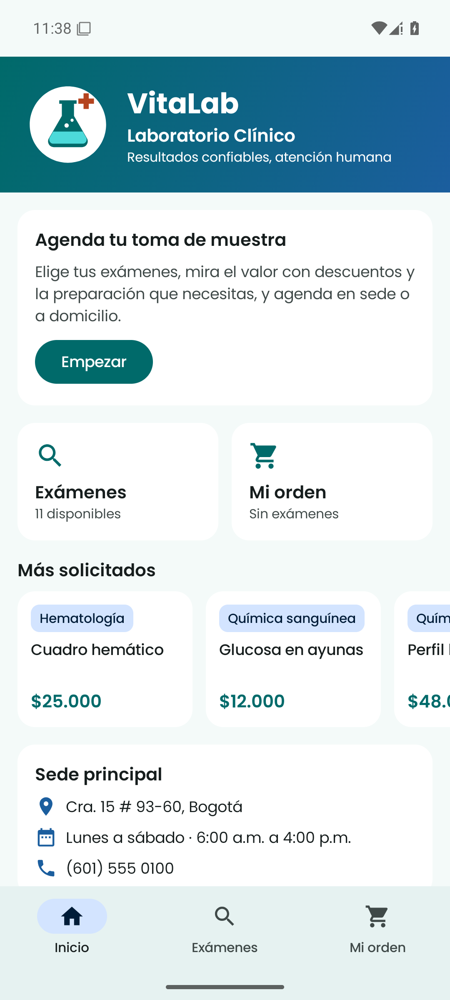
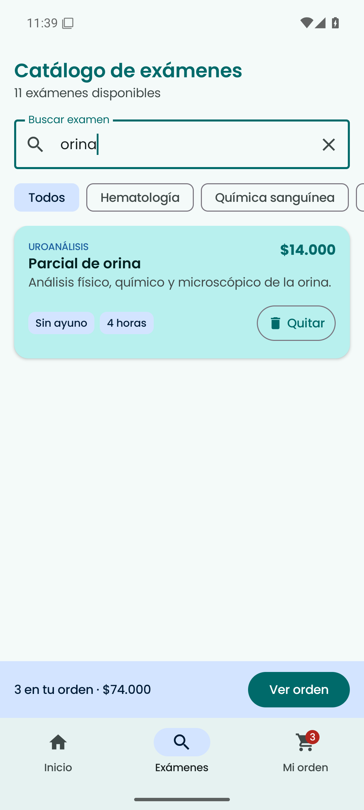
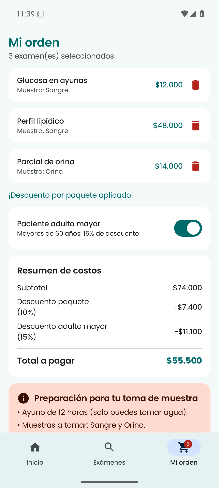
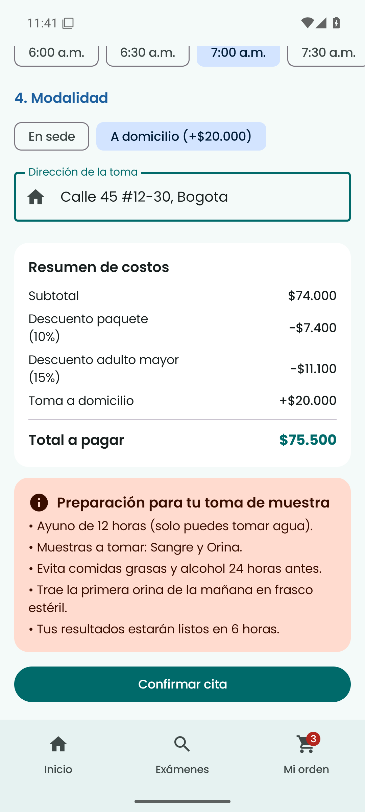
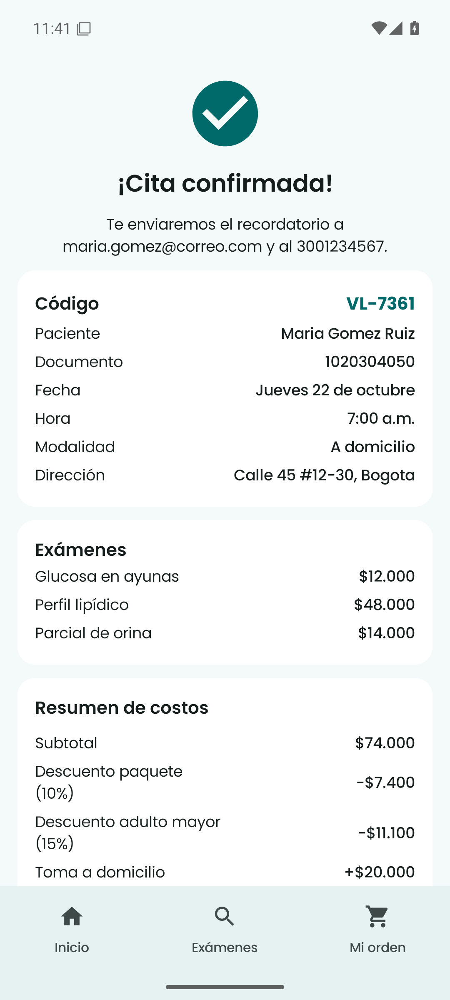

# VitaLab · Laboratorio Clínico

Aplicación móvil Android desarrollada con **Kotlin** y **Jetpack Compose** para el proyecto *Introducción a Jetpack Compose* de la asignatura Aplicativos Móviles.

## Negocio

**VitaLab** es un laboratorio clínico que realiza exámenes de sangre y orina (hematología, química sanguínea, hormonas, uroanálisis y pruebas infecciosas). Atiende en su sede principal y también toma muestras a domicilio.

## Objetivo de la aplicación

Permitir que un paciente:

1. consulte el catálogo de exámenes con precio, tipo de muestra, ayuno y tiempo de entrega;
2. arme su orden con los exámenes que le pidió el médico y vea el valor final con descuentos;
3. conozca la preparación que necesita (ayuno, muestras, indicaciones);
4. agende la toma de muestra en sede o a domicilio.

## Pantallas

La navegación usa **Navigation Compose** (`NavController` + `NavHost`) con una barra inferior (`NavigationBar`).

| Pantalla | Ruta | Propósito |
|---|---|---|
| **Inicio** | `inicio` | Identidad de la marca, próxima cita agendada, accesos rápidos, exámenes más solicitados (`LazyRow`) y datos de la sede. |
| **Exámenes** | `examenes` | Catálogo generado desde una lista (`LazyColumn`), con búsqueda, filtro por categoría (`LazyRow` de `FilterChip`) y botón Agregar o Quitar. |
| **Mi orden** | `orden` | Exámenes elegidos, descuentos, total e indicaciones de preparación. |
| **Agendar cita** | `cita` | Formulario con validaciones, fecha, hora, modalidad y confirmación. |

## Funcionalidades

### 1. Agregar y quitar exámenes de la orden (trabajada en clase)
Desde el catálogo cada examen se agrega o se quita de la orden. La tarjeta cambia de color y el botón cambia entre *Agregar* y *Quitar*. La orden se ve en otra pantalla (**Mi orden**), donde también se pueden quitar exámenes. La barra inferior muestra un contador (`Badge`). El catálogo incluye además búsqueda por nombre y filtro por categoría.

### 2. Cálculo automático del total con descuentos e indicaciones de preparación (nueva)
En **Mi orden** el valor se recalcula solo cada vez que cambia la orden:
- **Descuento por paquete:** 10 % si la orden tiene 3 o más exámenes. La app avisa cuántos exámenes faltan para obtenerlo.
- **Descuento adulto mayor:** 15 % al activar el `Switch` *Paciente adulto mayor*.
- **Recargo por toma a domicilio:** $20.000 al elegir esa modalidad en la cita.

También genera las **indicaciones de preparación** combinadas de todos los exámenes: el ayuno más largo, las muestras distintas (sangre u orina), las indicaciones especiales de cada examen y el tiempo de entrega más largo.

### 3. Agendamiento de toma de muestra con formulario validado (nueva)
En **Agendar cita** el paciente:
- llena nombre, documento, celular y correo (`OutlinedTextField`), y cada campo muestra su error si no es válido (documento de 6 a 10 dígitos, celular de 10 dígitos que empiece por 3, correo con formato válido);
- elige una **fecha** entre los próximos días hábiles (sin domingos);
- elige una **franja horaria**: si algún examen exige ayuno, solo se ofrecen franjas hasta las 9:00 a.m.;
- elige **en sede** o **a domicilio**, y en ese caso debe escribir la dirección.

Al confirmar se genera un **código de cita** y se muestra un resumen con todos los datos. La cita aparece en la pantalla de **Inicio** como *Tu próxima cita*.

## Estado, eventos y navegación

- El estado compartido (`orden`, `adultoMayor`, `cita`) vive en `LabApp` (`navigation/LabApp.kt`) con `remember { mutableStateListOf() }` y `mutableStateOf`. Se pasa a cada pantalla como parámetro, y las pantallas avisan los cambios con eventos (lambdas como `onAgregarQuitar`, `onQuitar`, `onConfirmar`). Esto es *state hoisting*.
- El estado local de cada pantalla (texto de búsqueda, categoría elegida, campos del formulario) usa `rememberSaveable`.
- `NavHost` define las 4 rutas. La barra inferior navega con `navController.navigate(ruta) { popUpTo(inicio); launchSingleTop = true }`. *Agendar cita* se abre desde *Mi orden* y vuelve con `popBackStack()`.

## Estructura del proyecto

```
app/src/main/java/com/vitalab/app/
├── MainActivity.kt
├── data/
│   ├── Examen.kt          # data class Examen + catálogo (11 exámenes)
│   └── Orden.kt           # descuentos, preparación, franjas, validaciones, formatos
├── navigation/
│   └── LabApp.kt          # Scaffold, NavigationBar, NavHost y estado compartido
└── ui/
    ├── components/
    │   └── Componentes.kt # composables reutilizables: ExamenCard, Etiqueta, FilaResumen,
    │                      # TarjetaResumenCosto, TarjetaIndicaciones, CampoValidado, EstadoVacio…
    ├── screens/
    │   ├── InicioScreen.kt
    │   ├── ExamenesScreen.kt
    │   ├── OrdenScreen.kt
    │   └── CitaScreen.kt
    └── theme/
        ├── Color.kt       # paleta turquesa clínico / azul / coral
        ├── Theme.kt       # esquemas claro y oscuro de Material 3 + formas
        └── Type.kt        # tipografía Poppins
app/src/test/java/com/vitalab/app/OrdenTest.kt   # pruebas de la lógica del negocio
```

## Identidad visual

- **Colores:** turquesa clínico (principal), azul confianza (secundario) y coral para avisos de preparación. Hay modo claro y modo oscuro.
- **Tipografía:** Poppins (Regular, Medium, SemiBold y Bold) en `res/font`.
- **Logo:** matraz de laboratorio con cruz médica (`res/drawable/ic_logo.xml`), usado también como ícono de la app.

## Capturas

| Inicio | Exámenes | Mi orden | Agendar cita | Confirmación |
|---|---|---|---|---|
|  |  |  |  |  |

## Cómo ejecutar el proyecto

1. Instala **Android Studio** (Ladybug o más reciente) con el SDK de Android 35.
2. Clona el repositorio:
   ```bash
   git clone https://github.com/<tu-usuario>/VitaLab.git
   ```
3. En Android Studio: **File → Open** y selecciona la carpeta `VitaLab`. Espera a que termine la sincronización de Gradle.
4. Crea o inicia un emulador (**Device Manager**) o conecta un celular con depuración USB.
5. Pulsa **Run ▶** (configuración `app`).

Desde la terminal:

```bash
./gradlew assembleDebug      # compila el APK (app/build/outputs/apk/debug/)
./gradlew testDebugUnitTest  # ejecuta las pruebas de lógica
```

No necesita internet, base de datos ni inicio de sesión: los datos son locales.
