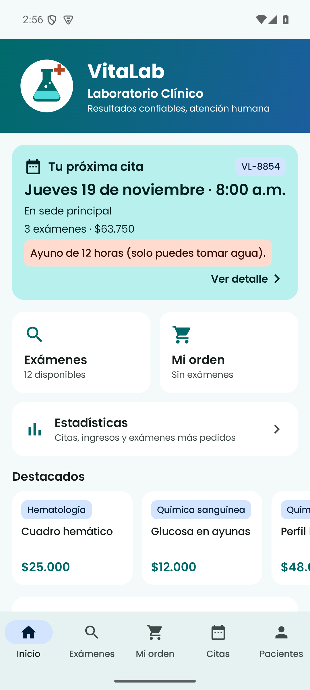
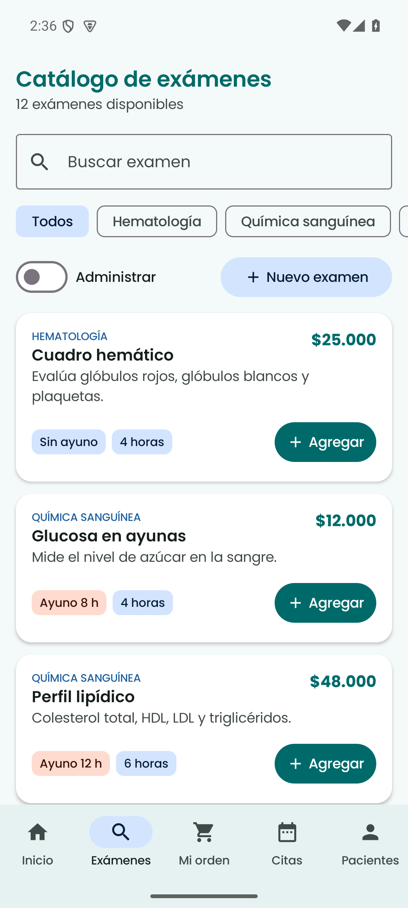
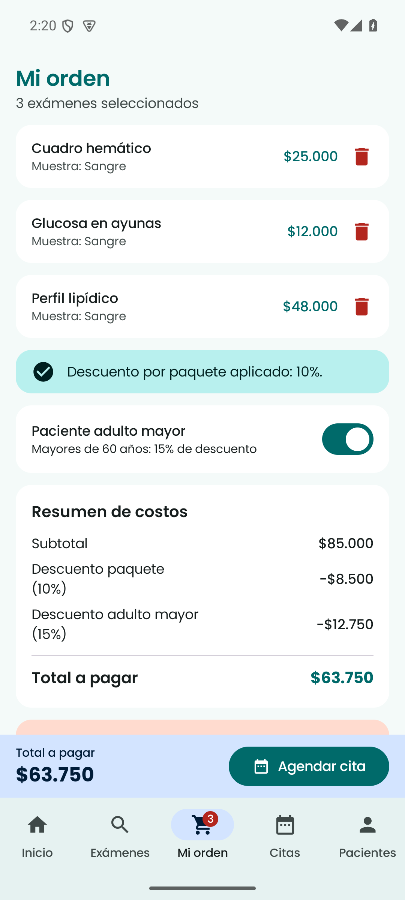
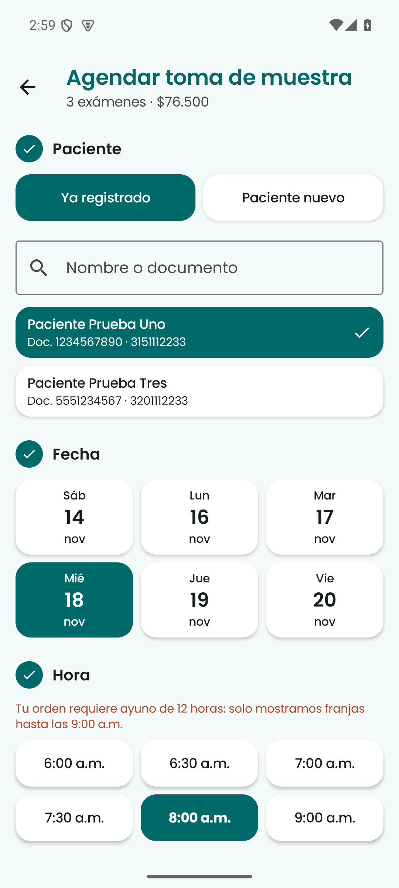
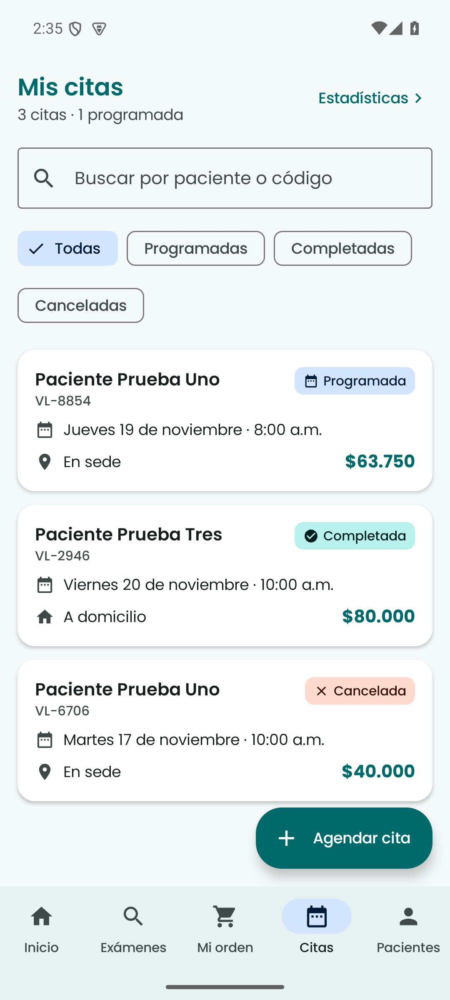
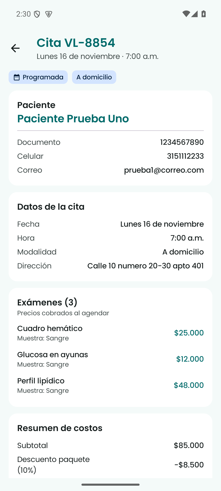
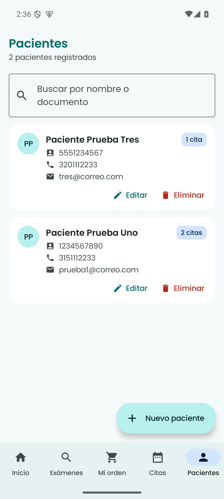
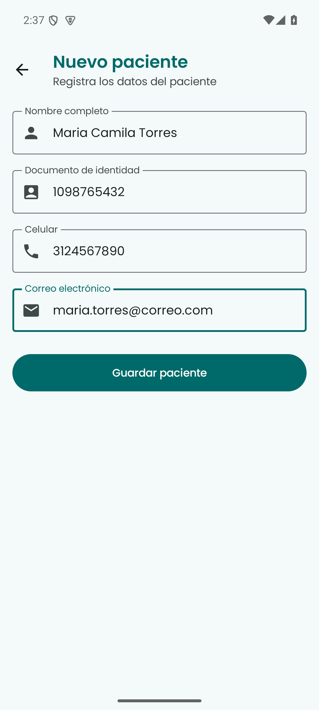
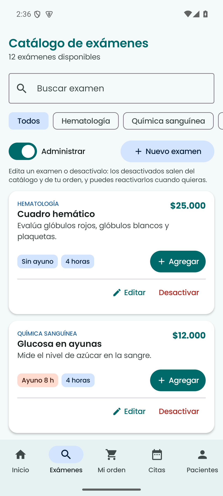
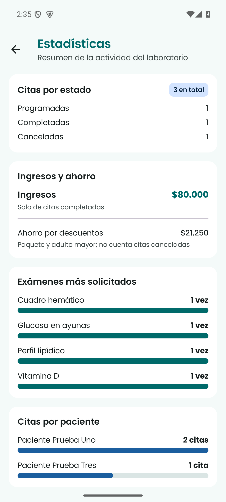

# VitaLab · Laboratorio Clínico

Aplicación móvil Android desarrollada con **Kotlin**, **Jetpack Compose** y **Room** para la asignatura *Aplicativos Móviles*.
Este es el **segundo corte**: evolución de la app del primer corte con arquitectura **MVVM** y almacenamiento local con **Room**.
Se conserva el propósito original (catálogo de exámenes, orden con descuentos, preparación y agendamiento) y ahora **todo se guarda en una base de datos local**.

## Negocio

**VitaLab** es un laboratorio clínico que realiza exámenes de sangre y orina (hematología, química sanguínea, hormonas, uroanálisis y pruebas infecciosas). Atiende en su sede principal y también toma muestras a domicilio.

## Qué cambió respecto al primer corte

| Primer corte | Segundo corte |
|---|---|
| Orden y cita en memoria (se perdían al cerrar la app) | Orden, pacientes, citas y catálogo en **Room**; sobreviven al cerrar y reabrir |
| Una sola cita, sin historial | **Historial de citas** con estados, detalle, reprogramación y estadísticas |
| Catálogo fijo en el código | Catálogo **administrable** (crear, editar, desactivar exámenes) |
| Estado dentro de `LabApp` | **MVVM**: ViewModels con `StateFlow`, repositorio y DAO |
| Ícono de plantilla | **Ícono propio** (matraz con cruz médica) |

## Funcionalidades nuevas y cómo probarlas

Todas leen y escriben en Room. La barra inferior tiene 5 pestañas: **Inicio · Exámenes · Mi orden · Citas · Pacientes**.

| # | Funcionalidad | Tipo | Cómo probarla |
|---|---|---|---|
| 1 | **Pacientes (CRUD completo)** | registro · consulta · edición · eliminación | Pestaña **Pacientes** → **Nuevo paciente** → llena nombre, documento, celular y correo → guardar. Busca por nombre o documento. Abre uno para **editarlo**. **Elimínalo** (pide confirmación y avisa que se borran sus citas). Repite un documento: aparece el error «Ya existe un paciente con el documento…». |
| 2 | **Agendar cita guardada en Room** | registro | **Exámenes** → agrega 3 → **Mi orden** → **Agendar cita** → elige un paciente (o crea uno nuevo) → fecha, hora y modalidad → **Confirmar cita**. Se genera un código `VL-xxxx`, la orden queda vacía y la cita aparece en **Citas**. |
| 3 | **Mis citas (lista y detalle)** | consulta | Pestaña **Citas** → filtra por estado (Todas, Programadas, Completadas, Canceladas) y busca por paciente o código. Abre una cita para ver exámenes, desglose de costos e indicaciones de preparación. |
| 4 | **Reprogramar cita** | edición | Detalle de una cita *programada* → **Reprogramar** → cambia fecha, hora, modalidad o dirección → guardar. El total se recalcula (por ejemplo, desaparece el recargo si pasa a «En sede»). |
| 5 | **Cambio de estado y eliminación** | estado / eliminación | Detalle de la cita → **Marcar completada** o **Cancelar cita** (con confirmación). **Eliminar del historial** la borra. Una cita completada o cancelada ya no se puede reprogramar. |
| 6 | **Estadísticas** | complementaria | Desde **Inicio** o desde **Citas** → **Estadísticas**: citas por estado, ingresos (solo completadas), ahorro por descuentos, exámenes más solicitados y citas por paciente. |
| 7 | **Administrar catálogo (CRUD de exámenes)** | registro · edición · estado | Pestaña **Exámenes** → activa **Administrar** → **Nuevo examen** (nombre, categoría, precio, muestra, ayuno, entrega) → guardar. **Editar** cambia el precio y los datos. **Desactivar** lo oculta de la orden (borrado lógico: las citas viejas conservan su información); **Reactivar** lo devuelve. |
| 8 | **Orden persistente** | persistencia | Agrega exámenes a la orden y activa *Paciente adulto mayor* → cierra la app por completo → ábrela de nuevo: **Mi orden** conserva exámenes y el interruptor. |

**Prueba global de persistencia:** crea un paciente, un examen y una cita; cierra la app del todo (deslizar fuera de recientes) y ábrela de nuevo. Todo sigue ahí.

### Reglas de negocio

- **Descuento por paquete:** 10 % del subtotal con 3 o más exámenes.
- **Descuento adulto mayor:** 15 % del subtotal. Los dos descuentos se **suman** sobre el subtotal (con ambos, 25 %).
- **Toma a domicilio:** recargo de $20.000 y dirección obligatoria.
- **Ayuno:** si algún examen exige ayuno, solo se ofrecen franjas hasta las 9:00 a. m.
- **Fechas:** desde el día siguiente, sin domingos.
- **Precios congelados:** cada cita guarda el precio de cada examen al momento de agendar; editar el catálogo no altera citas antiguas.

## Arquitectura (MVVM)

```
app/src/main/java/com/vitalab/app/
├── VitaLabApp.kt, AppContainer.kt     # Application y contenedor de dependencias (manual, sin Hilt)
├── data/
│   ├── Examen.kt, Orden.kt            # catálogo semilla y lógica pura (descuentos, validaciones, formatos)
│   ├── local/                         # entidades, DAOs, AppDatabase, relaciones y consultas
│   └── repository/                    # LabRepository (interfaz) + RoomLabRepository
├── viewmodel/                         # un ViewModel por pantalla, con StateFlow<UiState>
├── navigation/                        # Rutas y NavHost con barra inferior
└── ui/
    ├── components/                    # componentes reutilizables
    ├── screens/                       # pantallas Compose (sin lógica de negocio)
    └── theme/                         # paleta turquesa/azul/coral y tipografía Poppins
```

- **UI → ViewModel → Repository → DAO → Room.** Las pantallas solo reciben un `UiState` y emiten eventos.
- Las lecturas son `Flow` y los ViewModels las exponen como `StateFlow` (`collectAsStateWithLifecycle`).
- Las operaciones compuestas (crear una cita con sus exámenes y vaciar la orden) corren en **una transacción**.
- El repositorio devuelve `Resultado.Exito/Error` con mensajes claros; la UI nunca recibe una excepción de base de datos.

## Base de datos (Room, versión 1)

| Entidad | Descripción |
|---|---|
| `Examen` | Catálogo. Se siembra con 11 exámenes la primera vez. `activo` permite el borrado lógico. |
| `Paciente` | `documento` con índice único. CRUD completo. |
| `Cita` | Pertenece a un paciente (`FOREIGN KEY … ON DELETE CASCADE`). Estado `PROGRAMADA`/`COMPLETADA`/`CANCELADA` y desglose de costos. |
| `CitaExamen` | Tabla puente cita–examen con el precio congelado. |
| `OrdenItem` y `OrdenAjuste` | La orden en curso y el interruptor de adulto mayor, para que persistan. |

Relaciones: paciente 1—N cita, cita N—M examen. El esquema se exporta en `app/schemas/`.

## Identidad visual e ícono

Turquesa clínico (principal), azul (secundario) y coral para avisos. Modo claro y oscuro. Tipografía Poppins.
El **ícono de lanzamiento** es un matraz de laboratorio con cruz médica, adaptativo (redondo, cuadrado y *monocromático* para íconos con tema en Android 13+).

## Capturas

| Inicio | Exámenes | Mi orden | Agendar cita |
|---|---|---|---|
|  |  |  |  |

| Mis citas | Detalle de cita | Pacientes | Formulario de paciente |
|---|---|---|---|
|  |  |  |  |

| Administrar catálogo | Estadísticas | Ícono en el launcher |
|---|---|---|
|  |  |  |

## Cómo ejecutar el proyecto

**APK listo para instalar:** `entrega/VitaLab-segundo-corte.apk` (Android 8.0 o superior). Se instala sin compilar.

**Desde el código:**

1. Instala **Android Studio** (Ladybug o más reciente) con el SDK de Android 35 y JDK 17.
2. Clona el repositorio:
   ```bash
   git clone https://github.com/AlejandroRuiz444/AppLaboratorio.git
   ```
3. En Android Studio: **File → Open** y selecciona la carpeta clonada. Espera la sincronización de Gradle.
4. Inicia un emulador o conecta un celular y pulsa **Run ▶** (configuración `app`).

Desde la terminal:

```bash
./gradlew assembleDebug       # genera app/build/outputs/apk/debug/app-debug.apk
./gradlew testDebugUnitTest   # ejecuta las pruebas
```

No necesita internet ni inicio de sesión: los datos son locales.

## Pruebas automáticas

65 pruebas unitarias sin emulador (`./gradlew testDebugUnitTest`):

- **Room real en la JVM** (Robolectric): siembra de 11 exámenes, persistencia al cerrar y reabrir una base en archivo, documento duplicado, cita con 2 exámenes (totales y líneas), borrado en cascada, borrado lógico con una cita antigua, precio congelado, reprogramar, cambio de estado y estadísticas.
- **ViewModels** con un repositorio falso.
- **Lógica pura** (descuentos, franjas, validaciones) y **pantallas Compose** (filtros, diálogos de confirmación, formularios).

Además se probó el APK en un emulador Android 15: instalación limpia, los 8 flujos anteriores, rotación, modo oscuro y persistencia tras cerrar la app a la fuerza, comprobando el contenido de la base `vitalab.db`.

## Limitaciones conocidas

- La app no envía recordatorios por correo ni SMS: las citas se guardan solo en el dispositivo.
- Es una app de un solo usuario y sin inicio de sesión.
- La base está en la versión 1; no hay migraciones porque aún no ha cambiado el esquema.
- La tarjeta «Destacados» de Inicio es una selección fija de exámenes, no un ranking de solicitudes (el ranking real está en **Estadísticas**).
